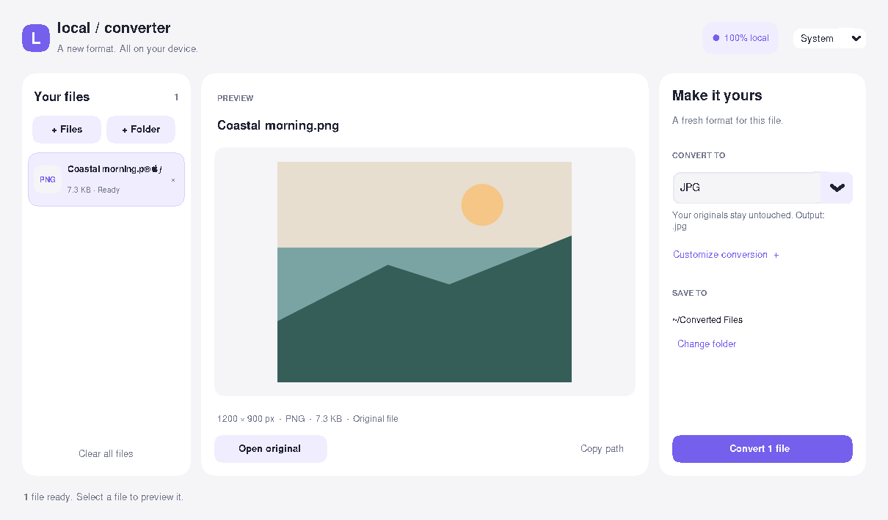

# Local File Converter

A Python desktop window for macOS, Windows, and Linux. Drop files or folders into the queue, pick an output format, and convert. Processing happens locally: no conversion APIs, accounts, uploads, analytics, or runtime downloads.

Inspired by the conversion workflow on [Tangerine](https://tangerineformac.com). This is an independent application with its own window UI, not an exhaustive reproduction of Tangerine.



## The desktop experience

The CustomTkinter window has a file queue, a preview workspace, and a contextual conversion panel. Start with a clean drop zone; tools and actions appear when they apply. Choose System, Light, or Dark appearance from the header.

- Preview images, navigate PDF pages, read documents and text, inspect CSV/XLSX rows and ZIP/TAR contents, or see video thumbnails and audio waveforms. **Open original** uses your default app for playback and full viewing.
- Previews load in background workers, stay in memory, and show the **original file**. They are not a simulation of crop, resize, or other pending conversion settings. Unsupported or unreadable formats show an explanation instead.
- Image quality appears for lossy image formats; crop/resize/rotate, media trimming, and PDF DPI appear only for matching conversions. **Customize conversion** keeps advanced fields collapsed until needed. Settings hidden because they do not apply are ignored.
- PDF merge appears for compatible image/PDF batches. Stop controls appear during conversion; output access and retry controls appear after results.
- Each queue card shows progress or its result. Failures have expandable inline details. **Retry unfinished files** only processes failed or skipped entries, preserving successful results.
- Large text previews are shortened; structured previews are capped at 20 MB. Image/PDF thumbnails are downsampled, audio waveforms cover the first 30 seconds, and media preview decoding has a 10-second timeout. Files are never uploaded for previews.

## Install and run

Use Python **3.10–3.13** with Tk support. After pulling an update, rerun `python -m pip install -r requirements.txt` using the same virtual environment as PyCharm; the redesigned window requires CustomTkinter. Initial package installation needs internet access; conversion works offline after installation. Pandoc is bundled in the Python dependencies when a compatible binary is available. The window still opens without it; document conversions require a working local Pandoc. Install FFmpeg separately for audio, video, and subtitles.

**macOS / Linux**

```sh
python3 -m venv .venv
.venv/bin/python -m pip install -r requirements.txt
.venv/bin/python converter.py
```

If macOS reports **Bad CPU type in executable** for bundled Pandoc, install a native build:

```sh
brew install pandoc
```

Restart the application after installation. It detects `/opt/homebrew/bin/pandoc` and `/usr/local/bin/pandoc`, including when PyCharm does not inherit your shell PATH. You can also set `PYPANDOC_PANDOC` in PyCharm's run configuration to the full path of a compatible Pandoc executable. No Rosetta installation is required by the application. Without compatible Pandoc, image, PDF, spreadsheet, compression, and available media conversions remain usable.

Python 3.14 has not been validated; Python 3.12 or 3.13 is recommended if you encounter other dependency issues. This particular error indicates an executable CPU architecture mismatch, rather than a Python syntax problem.

On macOS, the python.org Python installer includes Tk; Homebrew users need the matching `python-tk` package. Install FFmpeg with `brew install ffmpeg` if using Homebrew.

On Debian/Ubuntu, install `python3-venv python3-tk ffmpeg` using your package manager before creating the environment. Other Linux distributions provide equivalent packages. A graphical desktop is required for normal use.

**Windows (PowerShell)**

```powershell
py -3 -m venv .venv
.venv\Scripts\python.exe -m pip install -r requirements.txt
.venv\Scripts\python.exe converter.py
```

Use a Python installation with Tcl/Tk enabled. Install a local FFmpeg build and add its `bin` directory to PATH, then restart the application. The app reports whether FFmpeg is available.

The implementation uses cross-platform Python/Tk APIs. Linux has been tested here; macOS and Windows still require native validation. Binary wheel availability can depend on Python version and CPU architecture.

## Supported conversions

Only compatible destinations appear for the selected queue. A mixed queue shows its shared destinations. FFmpeg-dependent routes appear when FFmpeg is installed.

| Category | Input | Output |
| --- | --- | --- |
| Images | PNG, JPG/JPEG, WebP, HEIC/HEIF, AVIF, TIFF/TIF, BMP, GIF, ICO | Same image formats, PDF |
| Audio | MP3, WAV, FLAC, OGG, M4A, AAC, Opus, AIFF, WMA | Other listed audio formats |
| Video | MP4, MOV, MKV, WebM, AVI, MPEG, M4V, FLV, WMV, TS, MTS, 3GP | Other listed video formats, animated GIF, audio extraction |
| Documents / ebooks | Markdown, TXT, DOCX, EPUB, ODT, HTML, RTF, reStructuredText, Org, LaTeX | Markdown, TXT, HTML, DOCX, EPUB, ODT, RTF, reStructuredText, LaTeX, PDF |
| PDF | PDF | TXT, PNG/JPG pages, individual PDF pages, optimized PDF |
| Tables / spreadsheets | XLSX, ODS, CSV, TSV, JSON array of flat objects | Other listed table formats |
| Subtitles | SRT, VTT, ASS, SSA | Other listed subtitle formats, TXT |
| Compression | Any file | ZIP, TAR, GZIP, BZIP2, XZ |

## Tools and workflow

- Add multiple files, add a folder's immediate files, or drag files/folders into the window.
- Remove an individual queue card with its × button, or press Delete for the selected file. **Copy path** copies its path. Ctrl+O (Command+O on macOS) opens the file picker.
- Set image quality and a maximum pixel dimension; aspect ratio is preserved. ICO output is padded to a square.
- Expand **Customize conversion** for image crop (`x,y,width,height`), clockwise rotation, audio/video start/end seconds, and PDF export DPI (72–600).
- Crop runs before rotation and resize. Image settings only affect image inputs; PDF DPI affects PDF page rasterization.
- Choose **PDF · split pages** to split a PDF; choose **PDF** to optimize its internal streams. Optimization does not guarantee a smaller file.
- **Combine as PDF** merges the queued PDFs and images in queue order into `combined.pdf`.
- Conversions run in a worker thread. The window remains responsive; **Stop after current file** stops before the next queued file. An external-engine operation has a five-minute timeout. Combine as PDF is one operation.
- **Open output folder** opens the destination in your system file manager.
- Existing files are never overwritten, including source files. Choose a new destination or remove/rename an old output before repeating a conversion.
- Temporary conversion files are removed on success or failure. Each file's outputs roll back together if publication encounters a filename collision. Earlier successful queue entries remain.

## Practical limits

No converter supports every possible format or conversion pair. This version does **not** support Apple Pages, PowerPoint slides, legacy XLS, SVG, RAR, archive extraction/transcoding, OCR, or PDF-to-editable Office reconstruction. Compression creates one archive per input; selecting a ZIP as input wraps that file in a new archive rather than translating its contents.

Image conversion processes the first frame of animated or multi-frame images. Video-to-GIF creates an animation at 12 fps, capped at 640 pixels wide. Codec availability depends on your FFmpeg build; not every media file has an audio track to extract. Re-encoding may be lossy.

Document formatting is translated through Pandoc; PDF generation reflows HTML on A4 pages. Fonts, exact page layout, embedded media, and complex formatting may change. Pandoc runs with `--sandbox`: external resources, remote images, and include files are unavailable. FFmpeg input protocols are restricted to local files and pipes. PDF text extraction does not perform OCR. Password-protected PDFs are rejected.

Spreadsheets are **values only**: styling, charts, macros, and formulas are not converted. Formula and date cells are rejected with an explanation. XLSX/ODS preserve multiple sheets; conversion to a flat format requires one sheet and JSON requires unique text headers. Table CSV/TSV values become strings. Nested JSON is rejected. Spreadsheet strings beginning with `=` are saved as literal text in XLSX, not executed as formulas. ODS repeat expansion is bounded.

macOS-specific actions such as AirDrop, Finder drag interception, a global keyboard wheel, and floating file windows are not implemented. The ordinary application window works independently of those OS integrations.

## Validation

```sh
.venv/bin/python -m unittest discover -s tests -v
.venv/bin/python -m pip check
```

On Windows, substitute `.venv\Scripts\python.exe`. The tests create real files and validate conversions, media decoding and duration, image dimensions, PDF content and pages, spreadsheet roundtrips, existing-file protection, and rollback. The 46-test suite includes desktop checks for progressive controls, image/PDF previews, stale-preview handling, light/dark appearance, compact window layout, queue editing, background conversion, inline errors, retry, and safe stopping. GUI tests are skipped without a display; media tests are skipped without FFmpeg.

For this headless cloud environment, the installed Xorg dummy driver supplies a local test display:

```sh
source scripts/cloud-display.sh
.venv/bin/python -m unittest discover -s tests -v
.venv/bin/python converter.py
```

The virtual display is for internal validation, not a browser preview. On your own computer, launch the window directly on your desktop.
